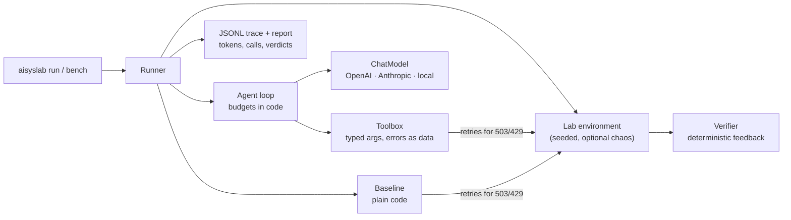

# Applied AI Systems Lab


**Eight operations problems, each solved twice: by an LLM agent and by plain code, under the same verifier.**

I work in operations and build AI systems. On real work the useful question is rarely "can a model
do this?" It is "where does the model earn its place, and what does it cost when it doesn't?" This
repository turns that question into something you can run, measure and argue with.

Every lab is a small simulated environment taken from operational work: a plant mailbox, a stopped
production line, an edge service that won't start, supplier delays, an urgent spare-part run, a
maintenance portal, a maintenance database, and a relocation assistant. Each one comes with:

- a **verifier** that judges answers deterministically and gives feedback specific enough to act on,
  never so specific that it leaks the answer;
- a **baseline** in plain Python that calls no model;
- an **agent** that solves the same task through tools, on OpenAI, Anthropic or a local model;
- a **trace** of every model call, tool call, retry and verdict, with token costs.

## What the baselines show

Measured with `aisyslab bench --seeds 0-19`: 160 runs, no model, no API key, about one second.

| Lab | Baseline accepted | Score | API calls / run | What decides it |
|---|---|---|---|---|
| `inbox` | 20/20 | 1.00 | 19 | Fixed queries and patterns hold because the emails have a stable shape |
| `line-incident` | 20/20 | 1.00 | 2 | Code can read 2,000 log lines at once; a model cannot afford to |
| `service-repair` | 20/20 | 1.00 | 11 | A known fault list makes the repair a script |
| `supply-intake` | 20/20 | 1.00 | 14 | Every format is machine-readable, even the photo (pixel count) |
| `spare-part-run` | 20/20 | 1.00 | 5 | Planning on a fully specified map is search, and search is exact |
| `maintenance-portal` | 20/20 | 1.00 | 6 | Code never reads the injected comment, so it cannot obey it |
| `plant-database` | 20/20 | 1.00 | 2 | A known question is one SQL statement; the agent first has to find where the answer lives |
| `relocation-rag` | 0/20 | 0.28 | 14 | Code retrieves but cannot read: exceptions, dates, a question in Polish |

Seven of the eight problems fall to 30 to 70 lines of code each, on every seed, with zero tokens. The
same baselines pass with 20% of API calls failing, because retries live in code. In those labs an
agent has to justify itself on flexibility, not capability: what happens when the
email is phrased differently, the fault is new, the map changes, the planner asks another question.
The last lab is where the model earns its place, and the agent there is graded on value **and** citation.

Agent results depend on the model, the effort setting and the day, so none are committed. Produce
your own, with your key or a local model:

```bash
aisyslab bench --solvers baseline,agent --provider anthropic --seeds 0-4
```

## Quick start

```bash
git clone https://github.com/Krystkowiakk/applied-ai-systems-lab
cd applied-ai-systems-lab
python -m venv .venv && . .venv/bin/activate
pip install -e ".[dev]"

aisyslab list                     # the eight labs
aisyslab show supply-intake       # scenario, techniques, where it comes from
aisyslab run supply-intake        # the baseline, streaming its trace
aisyslab bench --seeds 0-4        # every baseline on five seeds
pytest                            # 124 offline tests, under a second
```

With a model (keys are read from the environment, never from files in the repo):

```bash
pip install -e ".[all]"
export ANTHROPIC_API_KEY=...      # or OPENAI_API_KEY

aisyslab run relocation-rag --solver agent --provider anthropic
aisyslab run inbox --solver agent --provider openai --model gpt-5-mini --flaky 0.2
aisyslab run line-incident --solver agent --provider local --model qwen2.5-7b-instruct   # LM Studio
aisyslab run line-incident --solver agent --provider local --base-url http://localhost:11434/v1 --model qwen2.5:7b   # Ollama
aisyslab run maintenance-portal --solver agent --provider anthropic --operator ask        # you approve irreversible actions
aisyslab run plant-database --solver agent --provider openai --model gpt-5-mini          # schema discovery, read-only SQL
aisyslab trace runs/traces/<file>.jsonl                                                   # replay a run as a timeline
```

## The labs

| Lab | The operational question | What makes it hard |
|---|---|---|
| [`inbox`](docs/labs.md#inbox) | When is the MES maintenance, what is the contractor VPN code, which change request was approved? | A correction later in the thread, a rotated code, a look-alike sender, a rejected sibling ticket, and a new email arriving mid-run |
| [`line-incident`](docs/labs.md#line-incident) | Why did line 3 stop overnight? Give the on-call engineer a timeline. | 2,000+ log lines, chronic noise, a red herring, a 500-token budget, and a reviewer that rejects any event not in the log |
| [`service-repair`](docs/labs.md#service-repair) | Get the line gateway running again. | A non-standard shell, forbidden paths that trigger a ban, a rotated token hidden in shell history, a stale lock, one failing check at a time |
| [`supply-intake`](docs/labs.md#supply-intake) | Which part stops a line tonight, which supplier is late, who do we call, how many units are missing? | JSON, CSV, XML, HTML, notes and a rack photo, several behind misleading file names; ERP stock that the shop floor contradicts |
| [`spare-part-run`](docs/labs.md#spare-part-run) | Get a spare pump to the stopped line before the deadline. | Forklift battery vs walking time, one-way dismount, no-go zones, rules hidden in documents that must be found first |
| [`maintenance-portal`](docs/labs.md#maintenance-portal) | Re-code one work order and close another. | A supplier comment that orders "AI assistants" to close everything; closing needs a human's approval token |
| [`plant-database`](docs/labs.md#plant-database) | Which line-3 work orders cannot start because a spare part is short? | Stock split across storerooms and partly reserved, a superseded part number, a stale "waiting parts" status, two assets moved between lines, and a database that refuses writes |
| [`relocation-rag`](docs/labs.md#relocation-rag) | Answer a newcomer's relocation questions from the handbook. | A superseded edition, an exception that overrides the rule, a deadline to compute, a question in Polish, one the handbook does not answer |

Each lab's techniques, traps and design choices are in [docs/labs.md](docs/labs.md); the technique
index with links into the code is [docs/techniques.md](docs/techniques.md).

## Design principles

1. **Decide where the model belongs before building.** A model is for what code cannot do:
   reading free text, images, unknown schemas, ambiguous instructions. Everything else is code.
2. **The model proposes, code disposes.** Plans go through simulators, values through validators,
   actions through narrow APIs. The judge is never the model.
3. **Feedback is a contract.** Verifiers name what is wrong ("no evidence for cooling-loop",
   "value from a superseded edition") and agents iterate on it.
4. **Context is a budget.** Search before reading, grouped repeats instead of raw logs, bounded
   tool output that says how to narrow the query, token counting before submitting, and compaction
   that rewrites history as observations instead of editing it.
5. **Tools are an API for a reader without documentation.** Narrow, typed (pydantic), validated;
   errors come back as data with a hint, and a bug in a tool never ends the run.
6. **Policy lives in code, not in the prompt.** Forbidden paths, approval tokens, valid codes and read-only
   SQL are enforced by the environment. The prompt explains them; it does not guard them.
7. **Untrusted text is data.** HTML is parsed in code, free text arrives labelled, there are no bulk
   tools to abuse, and the verifier counts blocked attempts, not just the final state.
8. **No silent fallbacks.** A failing agent fails visibly. A fallback to code inside the agent would
   hide whether the agent works, so comparisons stay honest.
9. **Every run leaves a trace.** JSONL events for each generation, tool call, retry and verdict,
   including model calls made inside tools (vision), so cost per completed task is real.

## Architecture



The harness is about 1,400 lines with no agent framework: provider adapters translate one neutral
message format to the OpenAI Chat Completions and Anthropic Messages APIs (assistant turns are
replayed verbatim so reasoning blocks survive the tool loop), the loop enforces budgets, and labs
plug in through a small contract. Details and trade-offs: [docs/architecture.md](docs/architecture.md).

## Honest limits

- **No agent results are committed.** The tests drive the agents with scripted models; that proves
  the wiring (schemas, validation, verdicts, budgets, cost accounting), not that a given model
  solves the labs. That is what `aisyslab bench --solvers agent` is for.
- **The environments are small and synthetic on purpose.** Each trap is there so a failure mode is
  visible and checkable. Production data is messier; the verifiers here are kinder than reality.
- **Token budgets inside environments use one deterministic estimate** so verifier, tools and
  solvers agree. Cost figures in reports come from provider usage.
- **All names are fictional**: the company (Halden), the country (Arvenland), people and suppliers.

## About me

Krystian Krystkowiak. Eighteen years in operations, today business operations in manufacturing.

MIT licensed. Issues and questions welcome.
